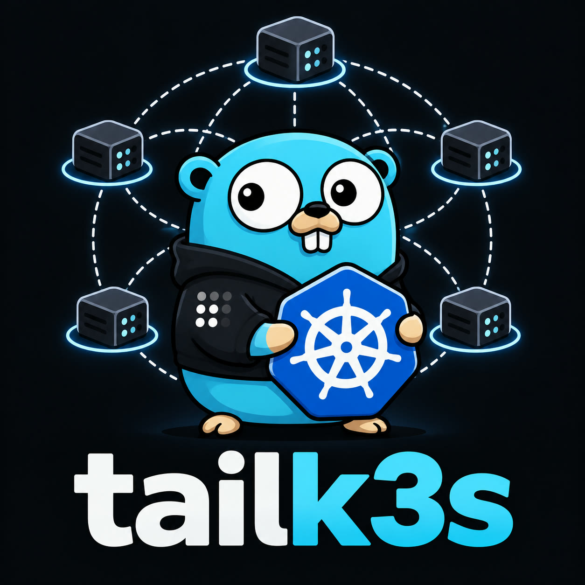

# tailk3s

Provision a k3s cluster on any VPS provider, over a Tailscale network.

You describe the servers in an HCL file. tailk3s joins them to your tailnet, installs k3s, and gives you a working cluster. It works with any provider that gives you a Linux server and SSH access. There is no VPC, no Ansible, and no state file.

## Requirements

- A Tailscale tailnet and an API access token. See [Security](#security) before creating it.
- Servers with a Linux distribution and systemd. Ubuntu is the tested target.
- SSH access to each server, with a password, a private key, or an agent.
- Outbound internet access on each server, for the packages, Tailscale and k3s.

## Install

```bash
go install github.com/ude-p/tailk3s/cmd/tailk3s@latest
```

From a checkout, `go build ./cmd/tailk3s` works too.

## Usage

Describe the cluster in a file.

```hcl
node "cp1" {
  host      = "203.0.113.10"
  role      = "server"
  init_user = "ubuntu"
  init_key  = env("SSH_KEY")
}

node "w1" {
  host      = "203.0.113.20"
  role      = "agent"
  join      = "cp1"
  init_user = "ubuntu"
  init_key  = env("SSH_KEY")
}
```

`host` is the address of the server. `role` is `server` or `agent`. `join` names the control plane an agent joins. A bare name must be a `server` in the same file. Use `join = "tag:prod-cp-server"` for a control plane that tailk3s does not provision.

`init_user` and `init_key` are the provider login. They are used for the first connection only, then the account is deleted. `init_password` works as well, for providers that give you one. The login must be able to run sudo.

Run the plan first.

```bash
tailk3s plan --config cluster.hcl
```

Apply it.

```bash
tailk3s up --config cluster.hcl
```

A single node can be described with flags instead of a file.

```bash
tailk3s up \
  --host 203.0.113.10 \
  --name cp1 \
  --role server \
  --init-user ubuntu \
  --init-key ~/.ssh/id_ed25519
```

For high availability, add more `server` nodes that join the first one. The first server initializes embedded etcd, later servers join the same etcd cluster, and agents receive every control plane address.

```hcl
node "cp2" {
  host      = "203.0.113.11"
  role      = "server"
  join      = "cp1"
  init_user = "ubuntu"
  init_key  = env("SSH_KEY")
}
```

## Environment

| Variable | Used for |
|---|---|
| `TAILK3S_API_KEY` | Tailscale API token. Updates the policy and creates auth keys. |
| `TAILK3S_TS_STATE` | Directory for the orchestrator's Tailscale state. Defaults to the working directory. |
| `TAILK3S_INIT_USER`, `TAILK3S_INIT_KEY`, `TAILK3S_INIT_PASSWORD` | Defaults for the provider login. |
| `TAILK3S_JOIN`, `TAILK3S_K3S_VERSION`, `TAILK3S_DISABLE` | Defaults for the flag mode. |
| `TAILK3S_GHCR_USER`, `TAILK3S_GHCR_TOKEN` | Registry credentials for private images. |

## How it works

tailk3s runs on your machine and joins the tailnet itself, as a node tagged `tag:tailk3s`. You do not need Tailscale installed on the machine that runs it. The only credential it needs is the API token.

The work happens in three phases.

**1. Prepare the tailnet**

- Read and validate the file.
- Update the access policy. Every node gets a tag, so the policy needs an owner for that tag and one SSH rule that lets tailk3s and administrators log in to machines wearing it. If the policy already says this, nothing is written.
- Create a single-use auth key for each node that is not on the tailnet yet. The keys expire after ten minutes.

**2. Put each machine on the tailnet**

- Connect with the provider login and install the base packages, set the hostname, create the `tailk3s` user, install Tailscale, and join the tailnet with the node's tag.
- This is the only time the provider password or key is used.

**3. Finish the cluster over the tailnet**

- Reconnect through Tailscale SSH and apply the firewall, k3s configuration and k3s installation.
- Read the join token from a control plane and pass it to agents. Nodes never need SSH access to each other.
- Write the kubeconfig and an SSH config entry on your machine.
- Delete the provider login.

Nodes that start a cluster are processed before nodes that join one. Every step checks the current state first, so running `up` again is a no-op and adding a node provisions only that node.

## What it installs on a node

| Stage | What happens |
|---|---|
| Base | Installs `openssh-server`, `sudo`, `curl`, `open-iscsi` and `nfs-common`. Starts `iscsid`. Sets the hostname. Creates the `tailk3s` user with passwordless sudo. |
| Tailscale | Installs Tailscale from the official script and runs `tailscale up --ssh` with the node's tag and hostname. |
| Firewall | Installs `ufw`. Denies incoming traffic except ports 80 and 443. Allows everything on `tailscale0`. Sets the forward policy to `ACCEPT` so pod traffic can cross nodes. |
| Registry | When a GHCR token is set, writes `/etc/rancher/k3s/registries.yaml`. |
| k3s | Writes `/etc/rancher/k3s/config.yaml` and installs the requested k3s version. Servers run `k3s`, agents run `k3s-agent`. |
| Kubeconfig | For servers, copies the k3s kubeconfig to `~/.kube/<node>.yaml` on your machine. |
| SSH config | Writes `~/.ssh/config.d/<node>` and includes it from `~/.ssh/config`. |
| Purge | Deletes the provider login, unless it is `root` or the `tailk3s` user. |

The k3s configuration uses the tailnet for cluster traffic. `node-ip` is the node's tailnet address, `node-external-ip` is the provider address, and `flannel-iface` is `tailscale0`. Servers add the tailnet address and hostname as TLS SANs.

The firewall does not block Kubernetes ports. It allows every port on `tailscale0`, so the API server, etcd, kubelet, flannel and NodePorts stay reachable over the tailnet. Only ports 80 and 443 are public.

## Security

The API token is the most sensitive credential here. It can rewrite your ACL and create auth keys, so a leaked token is effectively tailnet admin access. It must be allowed to read and write the tailnet policy and to create auth keys.

- Create the token right before a run, with the shortest expiry the admin console offers, and revoke it when the run finishes.
- Keep it in the environment or a secret manager. Do not commit it, put it in the cluster file, or bake it into an image.
- If a token leaks, revoke it first and then review the ACL for changes.

The orchestrator's state directory (`TAILK3S_TS_STATE`) holds the node key for the `tag:tailk3s` node. Anyone with that directory can act as the orchestrator. Keep it private and out of version control.

The provider login is deleted at the end of a successful run. The remaining admin account has no password and is reachable only through Tailscale SSH, as allowed by the ACL. If the tailnet is misconfigured, the provider console is the recovery path.

## Limitations

- It provisions a k3s cluster. It does not create VPCs, load balancers, DNS records, volumes or provider accounts.
- It assumes Linux with systemd. Ubuntu is the tested target.
- It is a one-shot provisioner, not a controller. It does not watch nodes or replace failed machines.
- It requires Tailscale. All cluster traffic is expected to use the tailnet.
- It does not deploy applications. Pair it with a GitOps tool such as Flux.

## Development

```bash
go build ./...
go test ./...
golangci-lint run
```
